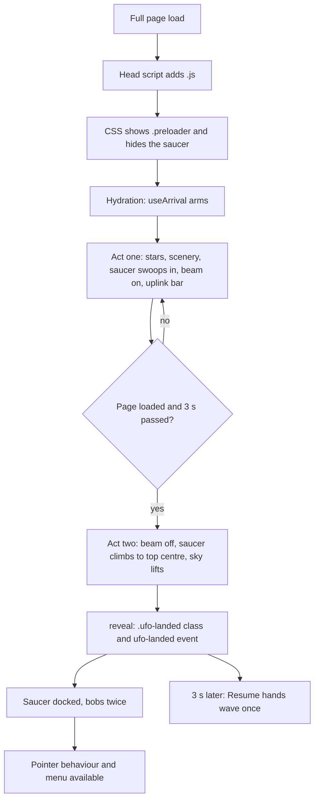
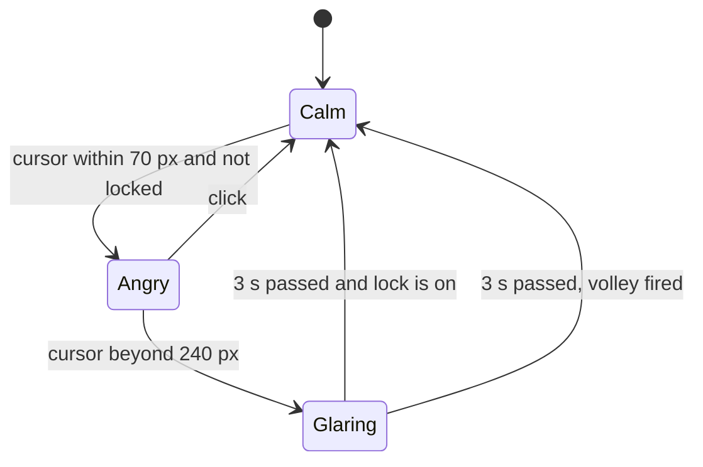

# UFO, preloader, menu, and roadmap trail

The site's navigation is a flying saucer. It is the first-load preloader, then the docked menu
button, then the source of the hologram menu. This file describes the flow and where each part lives.

## Parts

| Part              | File                                    | Job                                                           |
| ----------------- | --------------------------------------- | ------------------------------------------------------------- |
| Saucer drawing    | `src/components/space/saucer.tsx`       | Shared SVG: dome, disc, blinking lights                       |
| Menu button       | `src/components/nav/ufo-tab.tsx`        | The docked saucer; renders the preloader and the pellet layer |
| Preloader overlay | `src/components/nav/preloader.tsx`      | Night sky, scenery, beam, uplink bar                          |
| Preloader scenery | `src/components/space/deep-space.tsx`   | Meteors, asteroids, astronauts                                |
| Arrival timeline  | `src/components/nav/use-arrival.ts`     | Plays the two acts of the preloader                           |
| Pointer behaviour | `src/components/nav/use-ufo-pointer.ts` | Lean, shooting, anger                                         |
| Menu scene        | `src/components/nav/menu-panel.tsx`     | Open and close timeline                                       |
| Hologram          | `src/components/nav/menu-hologram.tsx`  | The beam and the page links                                   |
| Ground            | `src/components/nav/menu-ground.tsx`    | Planet surface, aliens, contact and social blocks             |
| Timing helpers    | `src/lib/page-load.ts`                  | `afterLoad`, `afterReveal`, reveal class and event            |
| Trail probe       | `src/components/space/probe.tsx`        | Rocket on the roadmap trail                                   |

## Flow

The preloader plays on every full page load, never on in-site navigation. With reduced motion there
is no preloader: the saucer docks at once and `reveal` runs immediately.

### Preloader rules

- Minimum time on screen is 3 s (`MIN_MS`). It never waits past 4.5 s for the load event (`MAX_MS`).
- The saucer is `inert` until it has docked, so it cannot be clicked, hovered, or focused.
- `afterReveal(delay, fn)` counts from the moment the page is visible. Use it for anything that must
  not happen behind the overlay. `afterLoad(delay, fn)` counts from the load event.

## Menu

Click the saucer. `MenuPanel` runs one timeline, strictly in this order:

1. Sky fades in.
2. Ground rises.
3. Saucer lowers into its hover spot (`[data-ufo-body]`).
4. Hologram beam scales on, then flickers like a projector catching.
5. Page links blur in one by one.
6. Aliens pop up holding contact and social blocks.

Closing reverses the same timeline at 1.7× speed: aliens leave, links vanish, the beam switches off,
and only then does the saucer fly back up. Reopening mid-close plays forward from where it is.

The saucer's own small cone hides while the menu is open, because the hologram is the beam.

The alien blocks are, in order: copy email, call, search (opens the Ctrl+K palette), local time in
India, then every profile from `primarySocials` and `otherSocials`.

## Pointer behaviour (`use-ufo-pointer.ts`)

Active only with a fine pointer, with motion allowed, once the saucer is docked, and while the menu
is closed.

- **Lean.** Cursor in the top 15% of the screen: the saucer drops 16 px and tilts toward it.
- **Shots.** The first volley is 5 s after the page loads. Later volleys come 30 to 45 s apart. A
  volley is 2 or 3 small white pellets at 380 px/s, scattered 26 px around the cursor.
- **Lock.** No two volleys are ever within 7 s of each other (`LOCK_MS`).
- **Anger.** The cursor within 70 px of the saucer turns it red and makes it shake, unless it fired
  less than 7 s ago. Clicking calms it. When the cursor then moves beyond 240 px, it waits 3 s
  (`GRUDGE_MS`) and fires at once, skipping the 30 to 45 s gap. If a scheduled volley fired during
  that wait, it only calms down.

## Roadmap trail

`RoadmapTrail` draws one SVG line down the page. Each `Section` declares its lane with
`data-trail-side`. The line swaps sides at section boundaries, so it also acts as the divider. A
probe rides the line: it faces along the path, fires its thruster while moving, and bobs at rest.
The section the probe is in gets `data-current`, which lights up its sideways heading.

## Tuning

| Setting                   | Where                                       | Value                |
| ------------------------- | ------------------------------------------- | -------------------- |
| Preloader minimum and cap | `use-arrival.ts`                            | 3000 ms, 4500 ms     |
| Resume hands wave delay   | `space/alien-hands.tsx`                     | 3000 ms after reveal |
| Lean zone                 | `use-ufo-pointer.ts` `ZONE`                 | 0.15                 |
| Shot timing               | `FIRST_SHOT_MS`, `FIRE_MIN_S`, `FIRE_MAX_S` | 5000 ms, 30 s, 45 s  |
| Shot lock                 | `LOCK_MS`                                   | 7000 ms              |
| Anger distances           | `NEAR_PX`, `FAR_PX`, `GRUDGE_MS`            | 70, 240, 3000        |
| Pellet speed              | `SPEED`                                     | 380 px/s             |
| Saucer dock offset        | `--ufo-top` in `globals.css`                | -0.5rem              |

## Reduced motion and touch

Reduced motion removes the preloader, the pointer behaviour, the meteors and astronauts, and the
menu animation steps. The menu then appears in its final state. Touch screens skip lean, shooting,
and anger.
