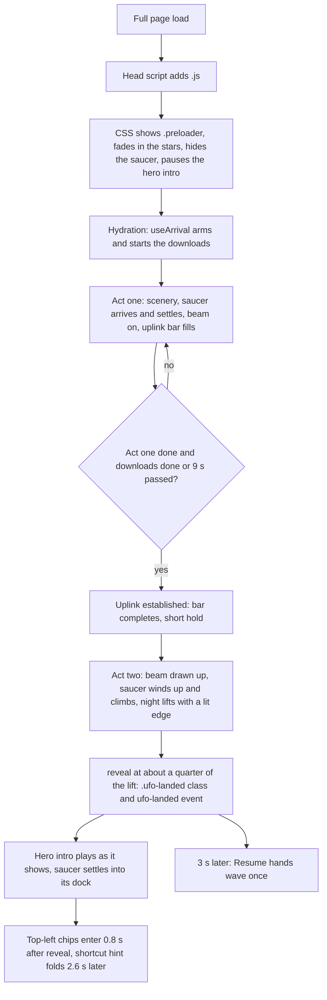
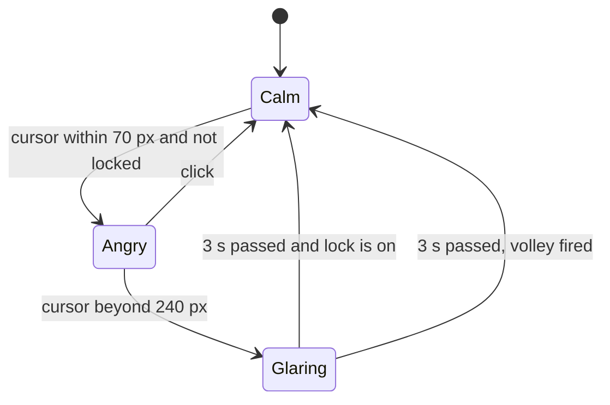

# UFO, preloader, menu, and roadmap trail

The site's navigation is a flying saucer. It is the first-load preloader, then the docked menu
button, then the source of the hologram menu. This file describes the flow and where each part lives.

## Parts

| Part              | File                                    | Job                                                            |
| ----------------- | --------------------------------------- | -------------------------------------------------------------- |
| Saucer drawing    | `src/components/space/saucer.tsx`       | Shared SVG: dome, disc, blinking lights                        |
| Menu button       | `src/components/nav/ufo-tab.tsx`        | The docked saucer; renders the preloader and the pellet layer  |
| Preloader overlay | `src/components/nav/preloader.tsx`      | Night sky, scenery, beam, uplink readout, lifting edge         |
| Preloader scenery | `src/components/space/deep-space.tsx`   | Meteors, asteroids, astronauts                                 |
| Arrival           | `src/components/nav/use-arrival.ts`     | Starts the downloads and the acts, and decides when to leave   |
| Arrival acts      | `src/components/nav/arrival-scenes.ts`  | Intro, uplink, and departure timelines                         |
| Uplink bar        | `src/components/nav/uplink-meter.ts`    | Bar and percentage from real progress and a minimum pace       |
| Downloads         | `src/components/nav/preload-page.ts`    | Document, fonts, images, live data, and album art              |
| Top-left chips    | `src/components/nav/top-mark.tsx`       | Home and palette chips; `use-top-mark-motion.ts` animates them |
| Pointer behaviour | `src/components/nav/use-ufo-pointer.ts` | Lean, shooting, anger                                          |
| Menu scene        | `src/components/nav/menu-panel.tsx`     | Open and close timeline                                        |
| Hologram          | `src/components/nav/menu-hologram.tsx`  | The beam and the page links                                    |
| Ground            | `src/components/nav/menu-ground.tsx`    | Planet surface, aliens, contact and social blocks              |
| Timing helpers    | `src/lib/page-load.ts`                  | `afterReveal`, reveal class and event                          |
| Trail probe       | `src/components/space/probe.tsx`        | Rocket on the roadmap trail                                    |

## Flow

The preloader plays on every full page load, never on in-site navigation. With reduced motion there
is no preloader: the saucer docks at once and `reveal` runs immediately.

### Preloader rules

- Act one runs about 2.8 s from hydration. The bar never fills faster than its pace (0.9 s), and it
  never runs ahead of the real download progress. On a fast load the night starts to lift about
  4.4 s after hydration, and `.ufo-landed` follows about 0.5 s later.
- The preloader downloads the document and stylesheets, the fonts, every image in the server markup
  (lazy images too), and the `/api/live` snapshot (Spotify, Discord, machine stats) with its album
  art. It does not load lazy component chunks: they still load near the viewport.
- It never waits past 9 s for the downloads (`MAX_MS`).
- The hero intro animations wait paused until `.ufo-landed`, so they always play on screen.
- The saucer is `inert` until it has docked, so it cannot be clicked, hovered, or focused.
- `afterReveal(delay, fn)` counts from the reveal. Use it for anything that must not happen behind
  the overlay.

## Menu

Phones (`max-width: 767px`) and larger screens get different menus. `site-nav.tsx` picks one with
`useMediaQuery`, and `lazy-overlays.ts` loads only that one.

### Desktop: hologram scene

Click the saucer. `MenuPanel` runs one timeline (`menu-timeline.ts`, about 1.35 s). The steps
overlap:

1. Sky fades in while the ground rises.
2. Saucer lowers into its hover spot (`[data-ufo-body]`) with a soft settle.
3. Hologram beam projects down from the saucer with a soft flicker that fades out.
4. Page links appear top to bottom, with a blur.
5. Aliens pop up holding contact and social blocks, in a wave from the centre outward.

Closing reverses the same timeline at 1.6× speed: aliens leave, links vanish, the beam switches off,
and only then does the saucer fly back up. Reopening mid-close plays forward from where it is.

The links are one centred column that grows with depth, like a projection. `holo-fit.ts` sizes each
row so that it stays inside the cone at that height. The saucer's own small cone hides while the
menu is open, because the hologram is the beam.

The alien blocks are, in order: copy email, call, search (opens the Ctrl+K palette), local time in
India, then every profile from `primarySocials` and `otherSocials`. `alien-crew.ts` gives each alien
a pose, a stand (ground, rock, or a friend's shoulders), a size, and idle actions. The choice comes
from a fixed hash of its position, so server and client render the same crew.

### Phones: flood sheet

`MenuSheet` has no hologram, ground, or saucer movement. A liquid flood pours down from under the
saucer (`liquid-path.ts`), the links rise in (`menu-links.tsx`), and the footer fades in
(`menu-footer.tsx`). Closing reverses it at 1.6× speed.

## Pointer behaviour (`use-ufo-pointer.ts`)

Active only with a fine pointer, with motion allowed, once the saucer is docked, and while the menu
is closed.

- **Lean.** Cursor in the top 15% of the screen: the saucer drops 16 px and tilts toward it.
- **Shots.** The first volley is 6 s after the reveal. Later volleys come 30 to 45 s apart. A
  volley is 2 or 3 small white pellets at 380 px/s, scattered 26 px around the cursor.
- **Lock.** No two volleys are ever within 7 s of each other (`LOCK_MS`).
- **Anger.** The cursor within 70 px of the saucer turns it red and makes it shake, unless it fired
  less than 7 s ago. Clicking calms it. When the cursor then moves beyond 240 px, it waits 3 s
  (`GRUDGE_MS`) and fires at once, skipping the 30 to 45 s gap. If a scheduled volley fired during
  that wait, it only calms down.

## Roadmap trail

`RoadmapTrail` draws one SVG line down the page. Each `Section` declares its lane with
`data-trail-side`. The line swaps sides at section boundaries, so it also acts as the divider. A
probe rides the line: it faces along the path, fires its thruster while moving, and bobs at rest.
The section the probe is in gets `data-current`, which lights up its sideways heading.

## Tuning

| Setting                 | Where                                       | Value                           |
| ----------------------- | ------------------------------------------- | ------------------------------- |
| Preloader download cap  | `use-arrival.ts` `MAX_MS`                   | 9000 ms                         |
| Act timing              | `arrival-scenes.ts`                         | `UPLINK_*`, `CLIMB_*`, `LIFT_*` |
| Resume hands wave delay | `space/alien-hands.tsx`                     | 3000 ms after reveal            |
| Lean zone               | `use-ufo-pointer.ts` `ZONE`                 | 0.15                            |
| Shot timing             | `FIRST_SHOT_MS`, `FIRE_MIN_S`, `FIRE_MAX_S` | 6000 ms, 30 s, 45 s             |
| Shot lock               | `LOCK_MS`                                   | 7000 ms                         |
| Anger distances         | `NEAR_PX`, `FAR_PX`, `GRUDGE_MS`            | 70, 240, 3000                   |
| Pellet speed            | `SPEED`                                     | 380 px/s                        |
| Saucer dock offset      | `--ufo-top` in `globals.css`                | -0.5rem                         |

## Reduced motion and touch

Reduced motion removes the preloader, the pointer behaviour, the meteors and astronauts, and the
menu animation steps. The menu then appears in its final state. Touch screens skip lean, shooting,
and anger.
